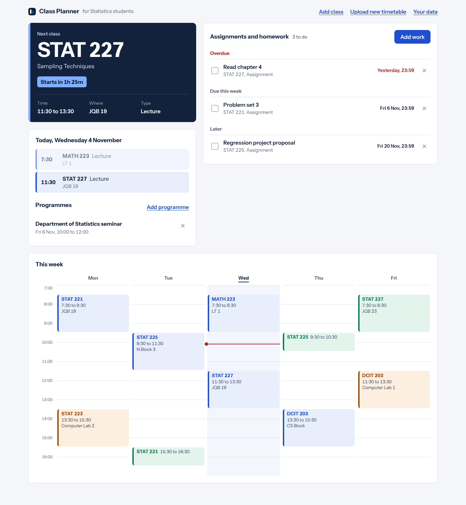
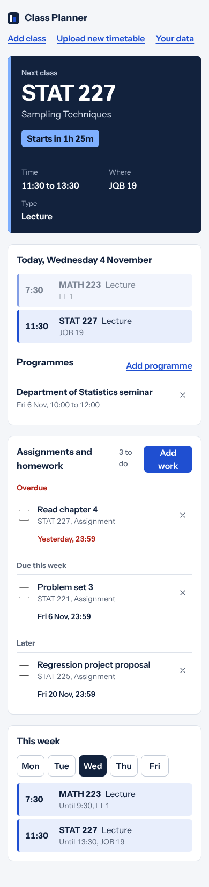

# Class Planner for Statistics students

Upload your timetable once and the dashboard tells you what class is next, where it is and how long until it starts. It also keeps track of assignments, homework and departmental programmes, so everything due this week is in one place.



I first built this idea in college for fellow statistics students. The original code was lost with my laptop before I'd pushed it to GitHub, so this is a fresh rebuild.

## What it does

* **Upload your timetable** as an Excel (.xlsx) or CSV file. Columns can be in any order and are matched loosely ("Course", "Code" and "Course code" all work). Times like `8:30`, `2:00 PM` and Excel time cells are all understood. You see a preview, with any rows it couldn't read and any clashing classes, before anything is saved.
* **Next class** at the top: course, time, venue and a countdown, or "Now" while it's on.
* **Today's classes** and a **week view** with a line showing the current time. On phones the week switches to one day at a time.
* **Assignments and homework** grouped into overdue, due this week and later, with due dates shown as "Today", "Tomorrow" or the date.
* **Programmes** for one-off events like seminars and department meetings.
* Add, edit or delete classes by hand too.
* **Private by default.** Everything is stored in your browser. Nothing is sent to a server. Export a backup to move it to another device.



## Timetable format

Download `public/timetable-template.csv` (also linked in the app) or use any sheet with a header row like this:

| Day | Start | End | Course code | Course title | Type | Venue | Lecturer |
| --- | --- | --- | --- | --- | --- | --- | --- |
| Monday | 7:30 | 9:30 | STAT 221 | Introductory Probability II | Lecture | JQB 19 | |

Only Day, Start, End and a course code or title are required. A single `Time` column such as `8:30 - 10:30` works instead of Start and End. Type can be Lecture, Tutorial or Practical.

## Run it locally

```sh
npm install
npm run dev      # start the app
npm test         # run the timetable parsing tests
npm run build    # production build in dist/
```

## Built with

React, TypeScript and Vite. [Papa Parse](https://www.papaparse.com/) reads CSV files and [read-excel-file](https://www.npmjs.com/package/read-excel-file) reads Excel files. Tests use Vitest.

The parts worth a look:

* `src/lib/importTimetable.ts` turns messy spreadsheet rows into classes, reports problems by row number and finds clashes.
* `src/lib/time.ts` parses the many ways people write times and days.
* `src/lib/schedule.ts` works out the next class and groups work by due date.

## Built by

Benedict Frimpong Boateng. See more of my work on my [portfolio](https://benedict-frimpong-boateng.vercel.app) or connect on [LinkedIn](https://www.linkedin.com/in/benedict-frimpong-boateng-552490249/).
